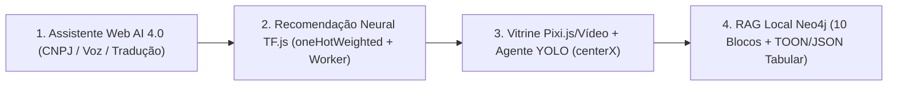

# Architecture Overview — Plataforma Full-Stack de IA Híbrida

## 1. Visão Arquitetural

A plataforma adota o padrão **Modular Monolith com Clean Architecture / Hexagonal (Ports & Adapters)** organizado em **Monorepo (`npm workspaces`)**:

- **`@platform/shared` (`packages/shared`):** Núcleo puro sem dependências de UI ou HTTP. Contém fórmulas matemáticas de domínio (`normalizeMinMax`, `oneHotWeighted`, `centerX`), serializadores (`JSON Tabular` e `TOON`), schemas de validação (`Zod` / `Ajv`) e contratos compartilhados.
- **`@platform/backend` (`packages/backend`):** Servidor HTTP/SSE em **Fastify**, pipeline de ingestão RAG (PDF/transcrições), geração local de embeddings (`@huggingface/transformers`), persistência vetorial no **Neo4j** e orquestrador **LLM Router** (`Ollama CPU -> OpenRouter`).
- **`@platform/frontend` (`packages/frontend`):** Aplicação **React + Vite** integrada com Web Workers para treinamento neural (`tf.sequential` + `tfvis`), Agente Visual (`YOLOv8n` + `Pixi.js`/Vídeo) e cadeia de adaptadores do Assistente Multimodal (`Gemini Nano -> Transformer.js -> Ollama -> OpenRouter`).

## 2. Diagrama de Fluxo Integrado

